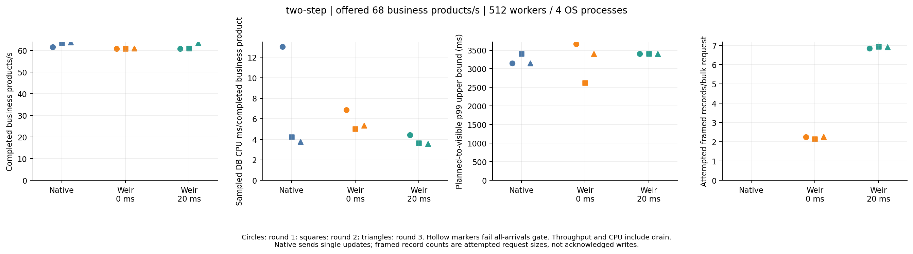
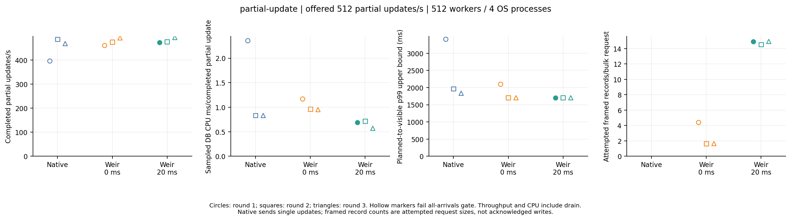

# Search batching collection window experiment

The prospective [plan](PLAN.md) separates a simple partial-update mechanism control from the unchanged two-step crawler workload. These are different logical units and independent workflows. Both compare native single-record callers with the **same Weir binary**, with its explicit collection window set to zero or 20 ms. No business repository, public SDK/protocol API, visibility, durability or safeguard is changed. The zero default remains unchanged.

The client source is `c0f9d6159ce542e5678f81d5d5f02846a157cbad`; both Weir paths use `49bab6ae1622fb389926269e976dd31385b075e5`. The [manifest](manifest.json) and [dispatch ledger](dispatch-receipts.json) retain immutable identities and every planned/dispatched run. The initial pre-dispatch server source adjustment is recorded in the plan and Git history. The [analysis](analyze.py) reuses historical immutable archive, settling, histogram and clipped CPU arithmetic helpers, with an original-client Go auditor rebuilt from a clean source archive ([receipt](auditor-build.json)). Platform-specific rebuilt auditor bytes may differ; the analysis records the supplied actual and historical hashes rather than requiring cross-platform byte equality.

## Short diagnostic evidence

The enabled-observer diagnostics are checks of correctness and counter consistency, not formal performance comparisons. Both workflows passed their original whole-report Go offline audit and source/cleanup checks. All six stages verified every field of all **3073 seeded documents**, including untouched sellers, other fields and rejected keys. No dispatched operation failed, timed out or had an unknown outcome. Every active metadata/mget/bulk/refresh internal attempted-HTTP counter exactly matched the observer ledger; actual mget/bulk framed-request histogram counts also matched attempted HTTP counts.

| Diagnostic | Path | Completed/offered | Rejected | Bulk attempted requests | Framed bulk records | Framed records/request |
| --- | --- | ---: | ---: | ---: | ---: | ---: |
| Partial update, 512 operations/s | Native | 2475/2560 | **85** | — | — | — |
| Partial update, 512 operations/s | Weir 0 ms | 2560/2560 | 0 | 1904 | 2560 | 1.34 |
| Partial update, 512 operations/s | Weir 20 ms | 2560/2560 | 0 | 217 | 2560 | 11.80 |
| Two-step crawler, 68 products/s | Native | 340/340 | 0 | — | — | — |
| Two-step crawler, 68 products/s | Weir 0 ms | 340/340 | 0 | 746 | 1360 | 1.82 |
| Two-step crawler, 68 products/s | Weir 20 ms | 340/340 | 0 | 197 | 1360 | 6.90 |

The partial native diagnostic rejected 85 arrivals and therefore cannot support a successful-all-arrivals comparison. Rejections remain in the raw evidence. The preset formal rate remains 512 operations/s; neither that negative result nor the apparent batch-fill increase selects another rate. The crawler diagnostic mget attempts were 780/321 for zero/20 ms, while both Weir paths evaluated Lua 1364 times. The four unchanged shared-seller operations account for 1364 logical calls versus 1360 framed write records; all four explicit refresh barriers remain. These observations establish actual collection behavior and usable instrumentation, not lower database CPU or higher capacity. The source bounds pre-read chunks before Lua and flushes the accumulated bulk after those chunks; one adapter invocation can therefore issue multiple mget requests. In the diagnostic, every mget attempt falls in the histogram bucket at or below eight records. That bucket is an upper bound, not an observed exact maximum. Search batches remain index-qualified; these count differences are not evidence of cross-index aggregation.

## Formal evidence

**At the predeclared 68 business products/s point, 20 ms collection reduced database CPU per completed crawler product versus native single updates in all three paired rounds, while completed throughput stayed within five percent.** Every crawler path completed all 1360 offered products per round and passed the predeclared all-arrivals gates. The same-binary zero/20 ms comparison also passed the strict CPU/QPS gates in all three rounds. This is evidence for this finite crawler model and offered rate; sustained database CPU was not established in every round, so it is not a capacity or production claim.

All four workflows passed immutable source/configuration/ownership/cleanup checks and the original frozen-client Go audit. All 18 formal stages passed measurement qualification and the full 3073-document oracle, with zero failed/unknown/timed-out dispatched work. Minimum clipped CPU coverage was **99.9755%**. Every stage independently attested the live before/after collection-window and unlimited-execution gauges. The complete evidence contains 24 timed stages including the six diagnostics, with every negative outcome retained.

### Crawler: all nine formal stages pass all-arrivals

| Round | Path | Completed products/s including drain | DB CPU ms/completed product | p99 upper bound (s) | Drain (s) | Attempted records/bulk |
| --- | --- | ---: | ---: | ---: | ---: | ---: |
| 1 | Native single update | 61.59 | 13.012 | 3.146 | 2.081 | — |
| 1 | Weir 0 ms | 60.80 | 6.868 | 3.670 | 2.369 | 2.25 |
| 1 | Weir 20 ms | 60.73 | 4.433 | 3.408 | 2.395 | 6.84 |
| 2 | Native single update | 63.48 | 4.238 | 3.408 | 1.425 | — |
| 2 | Weir 0 ms | 60.75 | 5.017 | 2.621 | 2.388 | 2.15 |
| 2 | Weir 20 ms | 60.93 | 3.621 | 3.408 | 2.320 | 6.93 |
| 3 | Native single update | 63.74 | 3.767 | 3.146 | 1.338 | — |
| 3 | Weir 0 ms | 60.98 | 5.336 | 3.408 | 2.303 | 2.26 |
| 3 | Weir 20 ms | 63.36 | 3.562 | 3.408 | 1.465 | 6.90 |

| Comparison: Weir 20 ms versus | Round 1 CPU ratio | Round 2 CPU ratio | Round 3 CPU ratio | Three QPS ratios | Strict gate |
| --- | ---: | ---: | ---: | --- | --- |
| Native single update | 0.3407 | 0.8544 | 0.9455 | 0.9860 / 0.9599 / 0.9941 | Pass |
| Weir 0 ms | 0.6455 | 0.7216 | 0.6674 | 0.9989 / 1.0030 / 1.0390 | Pass |

Against native, the CPU reductions are **65.93%, 14.56% and 5.45%**; against the same binary at zero wait, they are **35.45%, 27.84% and 33.26%**. The native CPU cost still falls from 13.012 to 4.238 to 3.767 ms/product despite 30-second warmup, so the size of the benefit is not stable. JIT/background/segment/order effects remain possible and were not isolated. Three paired rounds on one runner are not a confidence interval or a guarantee that production will reproduce the first-round reduction. Neither the zero-wait/native comparison nor the separate partial-update workflow passes the strict three-round improvement rule.

Actual crawler bulk requests at zero wait versus 20 ms were **2419/795**, **2536/785**, **2402/788**; each path framed 5440 write records and evaluated Lua 5454 times per round. Fourteen unchanged shared-seller operations keep their explicit visibility barriers on each Weir path. Mget attempted records also remain 5454 per round: larger batches reduce request overhead, not the number of document read/modify/write operations. These counts establish the proposed aggregation mechanism. They do not isolate all CPU contributors: Lua Evaluate wall-time totals also changed, so phase sums cannot assign the observed database CPU difference exclusively to one implementation step.



### Partial update: batching mechanism visible, strict performance gate fails

The 20 ms path completes all **10240/10240** offered partial updates in every round, with actual framed bulk size **14.93 / 14.52 / 14.93**, versus **4.39 / 1.63 / 1.65** at zero wait. Its sampled CPU cost is lower than native and zero wait in all three rounds, but this workflow does **not** pass the predeclared all-arrivals comparison gates: native rejects **1498** arrivals in round 1, zero wait rejects **179**, and maximum generator lag exceeds 50 ms for seven paths/rounds; native round 1 separately fails because of rejection. Missing a gate is not repaired by choosing a positive CPU ratio or dropping an unfavorable round.

| Round | Path | Completed/offered | Rejected | DB CPU ms/completed partial update | Maximum generator lag (ms) | All-arrivals |
| --- | --- | ---: | ---: | ---: | ---: | --- |
| 1 | Native single update | 8742/10240 | 1498 | 2.356 | 27.45 | Fail |
| 1 | Weir 0 ms | 10061/10240 | 179 | 1.168 | 79.95 | Fail |
| 1 | Weir 20 ms | 10240/10240 | 0 | 0.689 | 44.60 | Pass |
| 2 | Native single update | 10240/10240 | 0 | 0.832 | 64.73 | Fail |
| 2 | Weir 0 ms | 10240/10240 | 0 | 0.961 | 67.75 | Fail |
| 2 | Weir 20 ms | 10240/10240 | 0 | 0.718 | 69.36 | Fail |
| 3 | Native single update | 10240/10240 | 0 | 0.831 | 63.99 | Fail |
| 3 | Weir 0 ms | 10240/10240 | 0 | 0.950 | 65.76 | Fail |
| 3 | Weir 20 ms | 10240/10240 | 0 | 0.570 | 60.72 | Fail |

Only the native partial-update first round meets sustained database CPU qualification (93.24% sampled mean), and it rejects work. Other native partial rounds and every native crawler round fail that sustained-pressure gate. Consequently these runs do not establish a repeatable throughput ceiling or higher throughput at equal actual database load. Partial updates are not PSE business products; their lower per-operation cost cannot be used as a crawler result.



## Reproduction and measurement boundaries

From the repository root, use the original-client auditor declared by `auditor-build.json`:

```sh
PYTHONDONTWRITEBYTECODE=1 python3 results/batch-mechanism-2026-10-15/analyze.py \
  --auditor .tools/weir-crawler-batch-mechanism-audit
PYTHONDONTWRITEBYTECODE=1 python3 -m unittest discover \
  -s results/batch-mechanism-2026-10-15 -p test_analysis.py
```

`raw/*/files.json` inventories all 64 original archived artifacts across four workflows with compressed SHA-256, uncompressed SHA-256 and original byte length. The original workflow JSON, raw reports, command/source/config receipts, owned logs and cleanup receipts remain alongside both negative and positive rows. [Computed observations](analysis/analysis.json) retain every round, raw counter delta, CPU coverage, p99, drain and gate outcome. Workflows can run on different hardware; only compare paired paths/rounds within one workflow, and never combine the two logical units into a capacity curve.

Framed records are attempts at `client.Do`, not confirmed writes or proof of network delivery. HTTP duration includes body read/validation; bulk duration includes `refresh=wait_for`, so it is not pure indexing time. Lua duration covers Evaluate, including compilation and its internal conversion, and excludes JSON processing outside Evaluate and HTTP. Concurrent phase sums can exceed wall time; they are not exclusive critical-path durations. Missing counters remain `null`; absent Lua/mget on the expression path is not replaced with invented zero observations. Two snapshots can expose cancellation/tail/histogram boundary drift on unsuccessful stages; discrepancies are retained and cannot be silently reconciled. The enabled diagnostic observer adds a loopback hop and is absent from the formal measurements.

All configured database CPU quotas are verified, but equal quotas do not establish equal actual database load. A strict CPU improvement requires every paired round to pass the prospectively fixed all-arrivals gates, QPS within five percent, and lower database CPU ms/completed unit in every round. Capacity claims additionally require independently demonstrated sustained database CPU in every relevant formal round; this experiment makes no automatic maximum-capacity, production or distributed-network claim.
