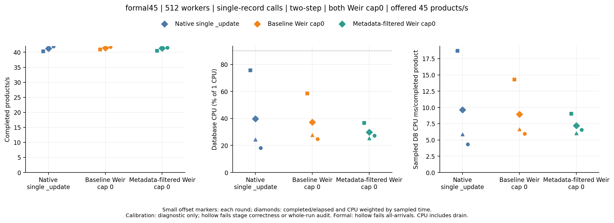
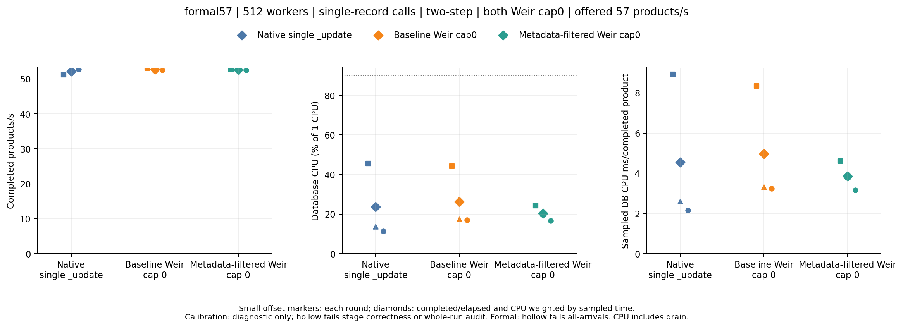
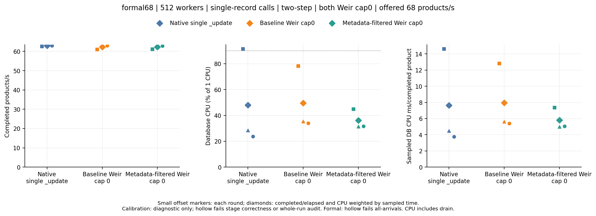
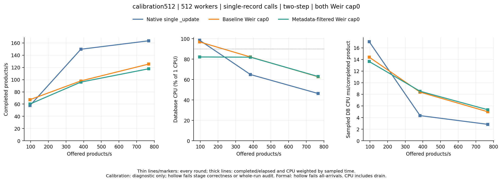
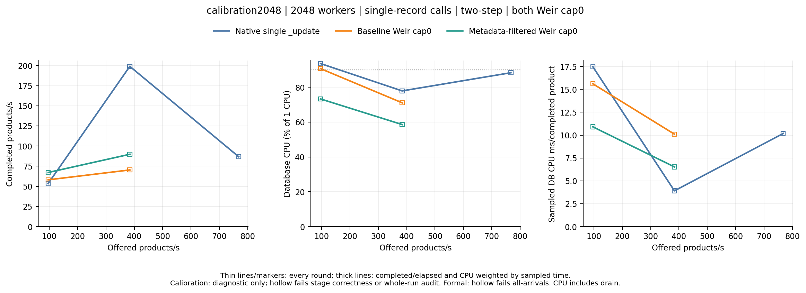

# Crawler database pressure experiment

The formal result supports one bounded improvement: at **68 offered products/s**, metadata-filtered Weir used **42.64%, 11.22% and 6.60% less database CPU per completed product** than baseline Weir in the three paired rounds, with completed throughput differing by at most **0.2%**. Both paths passed all-arrivals gates in every round. The 45/s and 57/s comparisons changed direction between rounds and do not support the same claim.

**None of the 27 formal stages met the sustained database CPU gate.** This experiment does not demonstrate a database CPU bottleneck, maximum capacity or higher throughput at equal actual database load. Neither Weir version consistently beat native single-record updates at any formal rate. The positive result is specific to this internal Weir optimization at 68/s, not a general Weir-versus-native advantage.

All three formal workflows passed their full original Go audits and every one of the **27 formal stages** passed measurement and all-arrivals gates: no failed, unknown, timed-out or rejected business products. The failed 2048-worker calibration and both warmup aborts remain intact below and in the raw archives.

## Frozen controls and provenance

Client/workflow/auditor source is `488b4575932265030b81312319b707e45649a028`; baseline Weir is `0f6fac3edb462e088decff98b67560dae2c23c9a`; metadata-only Weir is `745501319ae59a16351294c2eaed58019288c3ad`. The client comes from the immutable `randy/crawler-pressure-client` ref. Server sources and binary hashes, actual GitHub run identity, clean build receipts and unchanged executable hashes are verified.

Formal runs use 512 workers across four OS clients, a native pool ceiling of 384 per process, single-record native `_update` and SDK `Mutate` calls, two-step reconcile/product/parallel-sellers dependencies, page1, bounded queue1, 10-second planned-business deadlines, four maximum attempts, both Weir execution caps0 and observer disabled. QUERY_VISIBLE / refresh=wait_for, request durability, one-second refresh, two one-primary/zero-replica indices, 1 CPU quota, 512 MiB heap, 1536 MiB container memory, batch32 and 4096 pending records remain fixed. The full-field oracle verifies every seeded document (3073 per formal stage), including untouched/rejected keys. Business repositories, SDK and production settings are unchanged; Sink is excluded.

[PLAN.md](PLAN.md) was frozen before calibration. [SELECTION.md](SELECTION.md) applies the native-only rule before formal dispatch, giving Q57 and rates45/57/68. [Dispatch receipts](dispatch-receipts.json) preserve actual creation times and source identities recorded before inspecting results. Each rate is a separate runner; compare paths only within that workflow and round. Do not pool absolute CPU or throughput from different runners into a capacity curve.

## Formal results

| Offered products/s | Path | Completed/offered, all rounds | Completed/s range including drain | CPU ms/completed product range | Worst p99 upper bound (s) | Worst drain (s) |
| ---: | --- | ---: | ---: | ---: | ---: | ---: |
| 45 | Native single update | 2700/2700 | 40.337–41.958 | 4.336–18.728 | 3.146 | 2.312 |
| 45 | Baseline Weir | 2700/2700 | 40.937–41.778 | 5.945–14.306 | 3.408 | 1.985 |
| 45 | Metadata Weir | 2700/2700 | 40.460–41.981 | 6.019–9.043 | 3.408 | 2.244 |
| 57 | Native single update | 3420/3420 | 51.243–52.763 | 2.156–8.911 | 3.146 | 2.247 |
| 57 | Baseline Weir | 3420/3420 | 52.524–53.134 | 3.246–8.333 | 3.408 | 1.704 |
| 57 | Metadata Weir | 3420/3420 | 52.498–52.822 | 3.162–4.614 | 3.408 | 1.715 |
| 68 | Native single update | 4080/4080 | 62.556–63.402 | 3.769–14.612 | 3.932 | 1.740 |
| 68 | Baseline Weir | 4080/4080 | 61.039–63.036 | 5.399–12.820 | 3.670 | 2.281 |
| 68 | Metadata Weir | 4080/4080 | 61.091–62.972 | 4.993–7.354 | 3.408 | 2.262 |

Ranges expose the substantial within-run CPU drift rather than hiding it in one average. Completed throughput includes the entire drain. The 50 ms generator-lag, 5-second p99 and 3-second drain bounds are experimental gates, not production SLOs; histogram upper bounds retain the <=12.5% plus 1 microsecond approximation.

| Offered/s | Candidate / baseline CPU ms per product, rounds 1 / 2 / 3 | Candidate / baseline completed QPS, rounds 1 / 2 / 3 | Strict three-round lower-CPU result |
| ---: | --- | --- | --- |
| 45 | 0.632148 / 0.903662 / 1.104358 | 0.988362 / 1.007082 / 0.993701 | no, CPU direction reverses |
| 57 | 0.553679 / 1.151350 / 0.974241 | 0.994120 / 0.997937 / 1.000401 | no, CPU direction reverses |
| 68 | 0.573587 / 0.887753 / 0.934045 | 1.000852 / 0.998979 / 0.998119 | yes, this one rate only |

The same native comparisons are retained: candidate/native CPU-ms-per-product ratios are 0.482883 / 1.026429 / 1.514364 at 45/s, 0.517764 / 1.468118 / 1.466623 at 57/s, and 0.503259 / 1.110473 / 1.337990 at 68/s. Every native comparison reverses direction, so none supports a stable Weir advantage. Exact values and all baseline comparisons remain in [paired-rounds.csv](paired-rounds.csv) and [comparisons.csv](comparisons.csv).

The native 68/s first round had 91.43% mean CPU, but intervals at >=90% covered only 53.41% of the entire stage, below the frozen 80% requirement. Mean CPU alone cannot establish the declared sustained-pressure gate. All 27 formal sustained-CPU gates are false even though the short first calibration native stage had passed; calibration pressure is not transferred to formal results. No further matrix or threshold retuning is used.

[Formal 45/s workflow](https://github.com/batchstream/weir-tests/actions/runs/38738557033) — nine stages, original full Go audit passed.



[Formal 57/s workflow](https://github.com/batchstream/weir-tests/actions/runs/38738565573) — nine stages, original full Go audit passed.



[Formal 68/s workflow](https://github.com/batchstream/weir-tests/actions/runs/38738575421) — nine stages, original full Go audit passed.



## Retained calibration

Calibration is diagnostic only and uses 2-second warmup / 5-second arrivals / one rotating round. Its successful 512-worker report selects the formal points; the failed 2048-worker run is never reclassified as qualified.

## 512 workers

[Original workflow](https://github.com/batchstream/weir-tests/actions/runs/38736840274), runner exit `0`, original whole-report Go audit exit `0`. All nine stage positions and immutable provenance checks passed.

| Offered/s | Path | Completed/offered | Rejected | Failed / unknown | Completed/s with drain | DB CPU % | Sustained CPU |
| ---: | --- | ---: | ---: | ---: | ---: | ---: | --- |
| 96 | Native | 480/480 | 0 | 0 / 0 | 57.70 | 98.55 | yes |
| 96 | Weir baseline | 480/480 | 0 | 0 / 0 | 67.26 | 96.92 | yes |
| 96 | Weir metadata | 480/480 | 0 | 0 / 0 | 60.16 | 82.14 | no |
| 384 | Weir baseline | 1156/1920 | 764 | 0 / 0 | 97.93 | 82.12 | no |
| 384 | Weir metadata | 1248/1920 | 672 | 0 / 0 | 96.01 | 81.95 | no |
| 384 | Native | 1521/1920 | 399 | 0 / 0 | 149.75 | 64.93 | no |
| 768 | Weir metadata | 1480/3840 | 2360 | 0 / 0 | 117.77 | 62.96 | no |
| 768 | Native | 1536/3840 | 2304 | 0 / 0 | 163.55 | 46.31 | no |
| 768 | Weir baseline | 1485/3840 | 2355 | 0 / 0 | 125.45 | 62.72 | no |



## 2048 workers

[Original workflow](https://github.com/batchstream/weir-tests/actions/runs/38736847759), runner exit `1`, original whole-report Go audit exit `1`. All nine stage positions and immutable provenance checks passed; the 2048-worker overall business correctness audit did not pass.

| Offered/s | Path | Completed/offered | Rejected | Failed / unknown | Completed/s with drain | DB CPU % | Sustained CPU |
| ---: | --- | ---: | ---: | ---: | ---: | ---: | --- |
| 96 | Native | 480/480 | 0 | 0 / 0 | 53.55 | 93.63 | yes |
| 96 | Weir baseline | 480/480 | 0 | 0 / 0 | 58.10 | 90.72 | yes |
| 96 | Weir metadata | 480/480 | 0 | 0 / 0 | 67.20 | 73.31 | no |
| 384 | Weir baseline | 1060/1920 | 0 | 860 / 694 | 70.35 | 71.10 | no |
| 384 | Weir metadata | 1316/1920 | 0 | 604 / 474 | 89.80 | 58.61 | no |
| 384 | Native | 1920/1920 | 0 | 0 / 0 | 198.95 | 77.92 | no |
| 768 | Weir metadata | warmup failed | 0 | 0 / 0 | not timed | unavailable | no |
| 768 | Native | 1320/3840 | 0 | 2520 / 2520 | 86.82 | 88.37 | no |
| 768 | Weir baseline | warmup failed | 0 | 0 / 0 | not timed | unavailable | no |



All timed failures in the 2048-worker table were also timeouts. At 768 products/s, the candidate additionally had 18 failed/timed-out warmup products (18 unknown), and baseline had 35 (33 unknown); neither stage reached timing. Timed field-oracle failures on partial/unknown business outcomes mean those stages are unqualified; they are not silently treated as successful business updates or proof of data corruption. Detailed latency, drain, generator lag, field counts, call ledgers, CPU coverage and every negative row are in [stages.csv](stages.csv) and [analysis.json](analysis.json).

The sustained CPU rule is unchanged: at least five valid intervals, >=80% sampling coverage, >=90% mean CPU, and >=90% CPU over >=80% of the whole measurement including drain. For the selected native stage, mean CPU was 98.548%, coverage 99.926%, and time above the threshold 87.394%; all 480 products completed without failure or rejection and generator lag was 2.314 ms. Its p99 upper bound of 5.243 seconds and 3.319-second drain exceed the later formal all-arrivals limits. It is a diagnostic selection point, not a sustainable-rate claim.

The first short native stage is affected by the limited 2-second warmup and 5-second arrival period. Later 512-worker native stages show 64.93% and 46.31% CPU despite higher offered rates. Cold execution, JIT, database history and order effects are possible explanations, not isolated causes. The formal matrix must re-establish actual pressure in every round after 10-second warmup. Do not merge absolute CPU or throughput from different runners into a capacity curve. The larger worker level also enlarges the seeded working set (3073 versus 12289 records), so the two levels do not isolate concurrency alone.

## Reproduce the evidence

The five raw archives retain **80 files**, each with compressed SHA-256, uncompressed SHA-256 and byte length in `raw/*/files.json`: 45 original stages, 43 timed observations and two calibration warmup aborts. All source, command, stage-position, worker/pool, single-record ledger, owned database-log and cleanup checks pass. The original full Go auditor passes calibration512 and all three formal reports, and fails calibration2048. No partial-stage helper or modified report is used. Disabled backend HTTP request/byte counters remain unavailable.

Build `cmd/weir-crawler` from a clean checkout/archive of client commit `488b4575932265030b81312319b707e45649a028` using `go build -trimpath -buildvcs=false`, then supply that executable:

```sh
PYTHONDONTWRITEBYTECODE=1 python3 results/crawler-pressure-2026-10-15/analyze.py \
  --manifest results/crawler-pressure-2026-10-15/manifest.json \
  --auditor /absolute/path/to/rebuilt-weir-crawler \
  --output /tmp/weir-pressure-rebuilt
PYTHONDONTWRITEBYTECODE=1 python3 -m unittest discover \
  -s results/crawler-pressure-2026-10-15 -p test_analysis.py
```

[auditor-build.json](auditor-build.json) preserves the historical clean source/archive hash, Darwin binary hash and build metadata. Different-platform or differently linked same-source binaries can differ in bytes. The analyzer records the actual supplied auditor hash, historical hash and match flag without rejecting a valid source rebuild solely for a different hash. Rebuild from exact source A; a different hash alone does not establish source identity. [reproduction-check.json](reproduction-check.json) records a same-source, different-build-ID check with identical numerical rows, comparisons and selection.

Analysis code and numeric gates were frozen before formal results were inspected. Output records hashes of the independent analysis/summary/plot/archive/test sources and the supplied auditor. The portability validator correction changes no numeric calculation, workload, pressure threshold or selection rule. Historical batching and metadata-only result folders and calibration raw artifacts remain unchanged. The analysis performs no remote requests or database writes.
