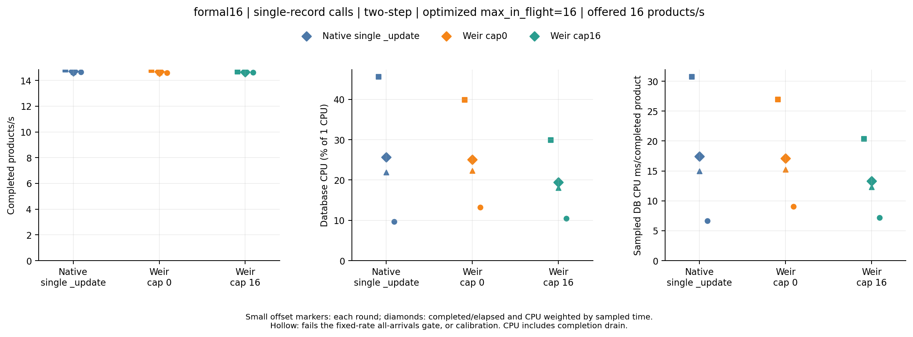
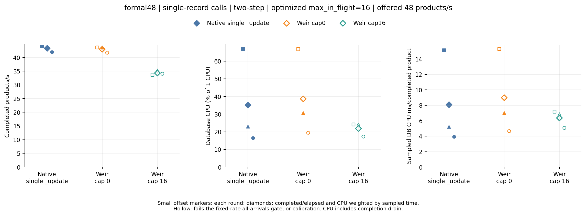

# Distributed single-record crawler benchmark, 2026-10-15

This experiment tests Weir with independently arriving single-record writes. It corrects the earlier [page-20 client control](../crawler-2026-10-15/README.md), which gave callers an already assembled batch and therefore did not represent the reference worker's individual product and seller calls. Only the test repository changes; business and production Weir code remain untouched. Sink and new Lua helper APIs are excluded. The metric is database load and completed business throughput; extra Weir CPU is outside the requested comparison.

## Finding

**The corrected single-record baseline still does not establish a consistent Weir database-load benefit over native atomic updates.** All 27 formal stages passed persisted-field checks and offline Go audit (CPU sampling coverage 99.966–99.988%), with zero failed/unknown/timed-out dispatched products. This is correctness evidence; it does not mean every offered arrival completed. Overload rejections and performance-gate failures remain in the results.

At 16 offered products/s, all paths completed every arrival and met the predeclared latency/drain/lag limits. Default Weir's paired CPU ms/product ratios against native were 0.876, 1.016 and 1.365; cap16's were 0.663, 0.821 and 1.083. The CPU direction reverses across rounds, so neither supports the predefined consistent-savings claim. Native CPU changed substantially across rounds; the short warmup and rotating order do not establish a stationary production estimate.

At 48 offered products/s, native completed all arrivals and met every round's gates. Default Weir completed all arrivals but missed the generator-lag limit in round1 and p99 in round3; its CPU/product exceeded native in each round. Cap16 rejected 319 of 2880 arrivals and had p99 7.34–8.39 s. At 96, every path rejected arrivals and missed the all-arrivals gate: these are overload observations, not sustainable capacity results.

There is one narrower configuration result: at 16, cap16 versus cap0 had comparable completed throughput in every round and reduced sampled CPU/product by **19.3–24.3%**, while both met all-arrivals gates. This isolates the execution cap within Weir; it does not establish an advantage over native. Higher offered rates did not preserve that service behavior.

The table retains per-round ranges; each offered rate is a separate workflow/runner. Compare paths within a rate, not absolute rates or CPU between runners.

| Offered products/s | Path | Completed / offered, three rounds | Rejected | Completed products/s range | Sampled DB CPU ms/product range | Worst p99 upper bound (s) | Worst drain (s) |
| --- | --- | --- | --- | --- | --- | --- | --- |
| 16 | Native single _update | 960/960 | 0 | 14.65–14.83 | 6.634–30.736 | 3.146 | 1.850 |
| 16 | Weir cap0 | 960/960 | 0 | 14.60–14.79 | 9.055–26.931 | 3.146 | 1.919 |
| 16 | Weir cap16 | 960/960 | 0 | 14.64–14.69 | 7.184–20.384 | 3.932 | 1.862 |
| 48 | Native single _update | 2880/2880 | 0 | 41.94–44.17 | 3.927–15.132 | 4.194 | 2.892 |
| 48 | Weir cap0 | 2880/2880 | 0 | 41.74–43.66 | 4.654–15.299 | 5.243 | 3.000 |
| 48 | Weir cap16 | 2561/2880 | 319 | 33.65–35.25 | 5.073–7.162 | 8.389 | 4.909 |
| 96 | Native single _update | 3858/5760 | 1902 | 48.08–58.81 | 3.888–13.950 | 6.291 | 4.045 |
| 96 | Weir cap0 | 3970/5760 | 1790 | 53.01–57.58 | 5.202–13.957 | 5.243 | 3.995 |
| 96 | Weir cap16 | 2836/5760 | 2924 | 35.33–38.14 | 4.930–6.327 | 8.389 | 5.957 |

All measured client calls contained one record. The server-side adapter fill below independently confirms Weir aggregated separate submissions, while the CPU and latency findings above show why aggregation alone is insufficient evidence of a benefit.

| Offered products/s | cap0 records/adapter execution | cap16 records/adapter execution |
| --- | --- | --- |
| 16 | 1.523 | 2.584 |
| 48 | 2.105 | 6.107 |
| 96 | 2.884 | 6.348 |





The client-call histograms certify one record per invocation, and server adapter counters independently record any aggregation. The existence of a server batch is a mechanism observation, not proof of useful load reduction. See the complete [stage table](analysis/stages.csv), [paired ratios](analysis/paired-rounds.csv) and [strict comparison gates](analysis/comparisons.csv).

| Run | Purpose | Workflow |
| --- | --- | --- |
| calibration | 4/16/48, one short round; no formal claim | [38727143882](https://github.com/batchstream/weir-tests/actions/runs/38727143882) |
| formal16 | 16, three full paired rounds | [38727911341](https://github.com/batchstream/weir-tests/actions/runs/38727911341) |
| formal48 | 48, three full paired rounds | [38727916942](https://github.com/batchstream/weir-tests/actions/runs/38727916942) |
| formal96 | 96, three full paired rounds | [38727921899](https://github.com/batchstream/weir-tests/actions/runs/38727921899) |

The [formal-rate decision](FORMAL-DECISION.md) was recorded before formal dispatch. Every calibration and formal stage is retained. No production or business code was tuned in response to the measurements.

## Submission and business completion

Four OS client processes own 32 goroutine workers each. One business product arrives at a time, scheduled from absolute timestamps independently of prior completion. Each worker reconciles one product, waits for query visibility, updates that product, waits again, then independently submits its two sellers concurrently and joins both acknowledgements. The synthetic shared placeholder adds a third separate seller when `(worker + page) % 100 == 0`. Every native HTTP `_update` and every Weir SDK `Mutate` call contains exactly one record. Native uses cached atomic Painless; Weir runs the frozen Lua translation outside the database. Neither caller creates a batch, adds an aggregation window or shares a client-side aggregator across processes.

The native HTTP pool allows 96 connections per process (three per worker), sufficient for the maximum seller fan-out. Each worker records actual application invocation attempts and their record-count histogram; child and stage totals are recomputed and audited. For successful work, the independently regenerated acknowledged arrivals must account for the same number of logical records. Empty workers and partial failures are retained. These counters prove input submission shape; they do not count every transport retry, wire message or database-facing Weir command. Native HTTP attempts and Weir SDK calls are distinguished in the analysis.

A completed business product requires every causal phase and seller to be durably acknowledged and query-visible. Business latency runs from the planned arrival to the final acknowledgement, including queueing. Throughput divides successful products by the full arrival window plus every completion drain. An arrival has four logical record mutations, plus a possible placeholder; reported shared counts are actual synthetic counts, not a production percentage. Rejected arrivals have no completed latency. A failed business product can have partially applied records, so an oracle mismatch after failure does not establish loss after a successful acknowledgement.

All 769 seeded documents, including untouched or rejected keys, are read by normal searchable state and compared against an independent field/type oracle. The offline Go audit reconstructs the canonical expected-document hash from acknowledged arrival ordinals. Input/output semantics cover the generated fixture, not arbitrary Lua or every production branch. Individual arrival shape also reduces the seeded working set relative to page20; do not subtract those runs and call the result a pure batching effect.

## Fixed controls and provenance

Client source is `ad1879156c14028285f27f18794f1580e979af63`. Both Weir paths use exactly `c3101c6628872345d6fb09b977ce853f25936b79` and matching binary hashes. The default path uses `max_in_flight=0`; the experimental path alone uses 16, attested by live before/after gauges. All three paths within each workflow share one owned Elasticsearch container with 1 CPU quota, 512 MiB JVM heap and 1536 MiB container memory. The two indices each have one primary, zero replicas, one-second refresh and request translog durability. Native and Weir each allow four total conflict attempts. Request deadlines remain 10 s and the client queue remains one business arrival per worker.

Every path bypasses the HTTP measurement proxy. Database-facing HTTP counts and bytes therefore remain unavailable, not zero. Database CPU comes from cumulative owned-container counters clipped to measured intervals without extrapolation; CPU coverage is reported. Native index/get/refresh/merge statistics and Weir adapter records/execution counters are retained. Adapter fill shows server aggregation of separate calls; it is not a complete database request count. Bounded owned database logs and process/container cleanup receipts are archived with raw reports.

Pools remain open across warmup, a deterministic reset and measurement. Both resets require at least two quiet seconds of index/merge/flush observations. Paths rotate within each workflow; persistent database history and JVM/JIT effects may still vary by order. Server/client source, clean state, executable hashes before/after, exact command, dependency versions, CPU/host/kernel, image identity and actual quota are verified from receipts. Each formal rate has its own workflow and host, with three paired paths and three rotating rounds. Comparisons stay within that workflow and round; absolute rates or CPU across runners are never joined into a capacity curve.

The [predeclared plan](PLAN.md) fixes calibration and rate selection before the results. Calibration uses 4/16/48 offered products/s, 2 s warmup, 5 s arrivals and one round. It is diagnostic only. Formal runs use 10 s warmup, 20 s arrivals and three rounds. Full measurement requires matching provenance, complete matrix, successful cleanup and field/offline audits, no failed/unknown/timed-out dispatched work, and >=80% CPU coverage. The all-arrivals gate additionally requires no rejection, all arrivals completed, business p99 <=5 s, drain <=3 s and generator lag <=50 ms in every round. Quantiles are inclusive histogram upper bounds with at most 12.5% plus 1 microsecond approximation. These gates are experiment limits, not production SLOs.

Lower CPU at comparable completed throughput additionally requires paired completed QPS within +/-5% in every round and a consistent CPU-per-product direction across all three rounds. Equal CPU quota means equal budget, not equal observed database load. A throughput improvement at equal actual load needs a matching observation; a single offered rate or a larger batch alone does not prove it. Three rounds do not establish production capacity or a precise confidence interval.

## Reproduce

Each raw directory includes deterministic gzip artifacts and a `files.json` inventory with compressed SHA-256, original SHA-256 and original byte count. The experiment's `summarize.py` calculation is frozen locally rather than importing the mutable repository summarizer. The generated analysis records the hashes of its scripts and the exact offline auditor binary. The manifest binds each report to its workflow and immutable client.

From the repository root, build the offline auditor with the declared Go version and rerun analysis without databases:

```sh
go build -trimpath -buildvcs=false -o .tools/weir-crawler-single-audit ./cmd/weir-crawler
python3 results/crawler-single-2026-10-15/analyze.py \
  --manifest results/crawler-single-2026-10-15/manifest.json \
  --auditor .tools/weir-crawler-single-audit \
  --output results/crawler-single-2026-10-15/analysis
```

Optional plots use `requirements-plot.txt`:

```sh
python3 results/crawler-single-2026-10-15/plot.py \
  --analysis results/crawler-single-2026-10-15/analysis/analysis.json \
  --output results/crawler-single-2026-10-15/plots
```

Every failed, rejected or unmeasured stage remains in the stage CSV. Failed Go audits remain failure evidence and never become qualified measurements. Cleanup receipts certify the final owned process and removed database container; earlier server replacements synchronously wait in fixture code but do not have separate historical OS termination receipts. Clients, Weir and the owned database run on the same host; independent machines, network RTT, production key distributions, replicas and multi-node database scaling are not modeled.
