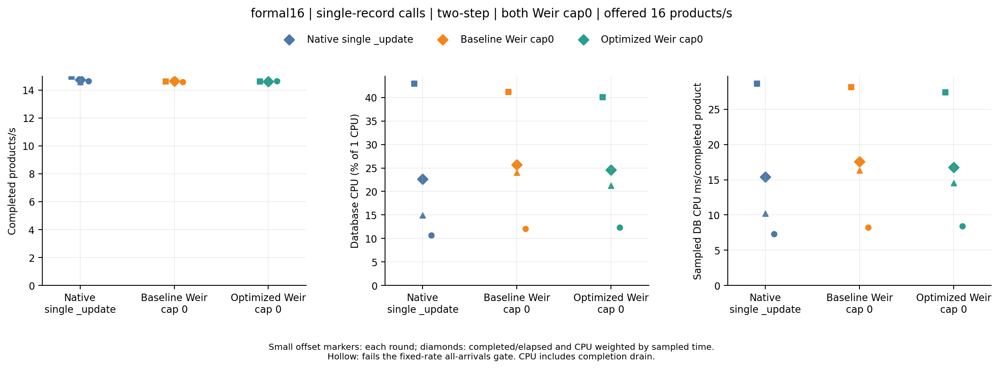
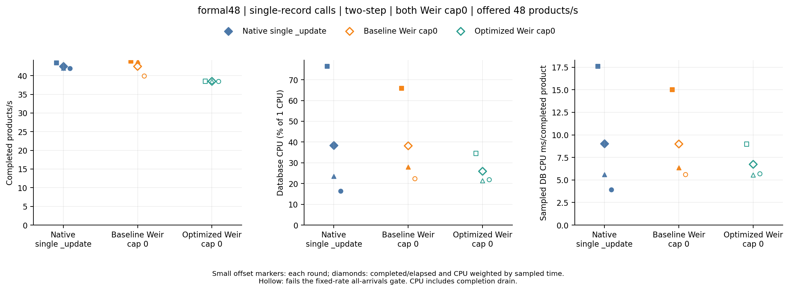
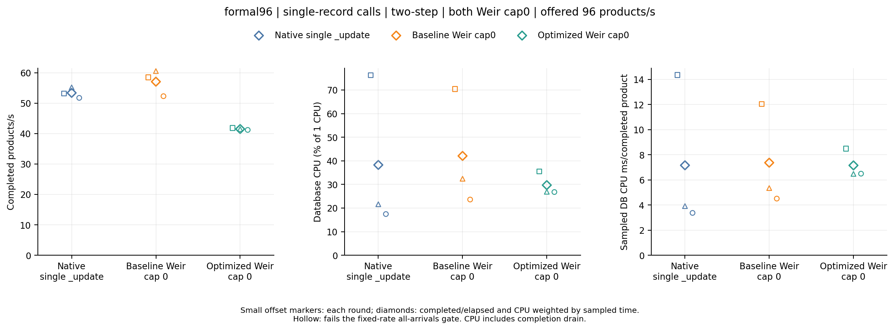

# Search cross-index batching candidate, 2026-10-15

**The mixed candidate is rejected: it reduces completed throughput and worsens latency at the two higher offered rates.** Its immutable source is `b13318ffcfde662d5f77209ef88d689bdcd2433d`. This implementation was tested as the initial version of Weir PR 66 and was not merged or released. PR 66 now removes the mixed implementation and contains the separate metadata-only candidate `745501319ae59a16351294c2eaed58019288c3ad`; these results describe the original `b13318f...` implementation and cannot validate the revised PR.

The candidate combined compatible Search work across indices, used a shared `/_mget` request shape, and filtered metadata response fields. These measurements assess that combined change. They do not isolate which part caused the regression; a metadata-only ablation requires a separately declared experiment and immutable source.

## Result

All three workflows succeeded. Every one of the 27 timed stages passed the complete source, command, process, ownership, arithmetic, application-call, persisted-field and independent offline Go audits. Every stage verified all 769 seeded documents, and dispatched business work had zero failures, indeterminate outcomes or timeouts. Clipped database CPU sampling coverage was **99.9690–99.9891%**. These checks establish correct acknowledged results for this fixture, not acceptable performance: only 14 of the 27 stages passed the predeclared all-arrivals gate.

At 16 offered products/s, all paths completed every arrival and passed every round's gates. Candidate/baseline CPU ms/completed-product ratios were **0.972, 0.892 and 1.024**, with completed-throughput ratios **0.999, 0.994 and 1.002**. The CPU direction reverses, so this rate does not support the predefined consistent-savings claim.

At 48, candidate completed throughput was **12.3%, 12.3% and 3.6% lower** than baseline in the paired rounds. The candidate's planned-to-visible p99 upper bound was 5.767 seconds in every round, with 4.908–4.970 seconds of drain; all three candidate stages failed the gate, and the first rejected one arrival. Baseline passed rounds 1 and 2, then also failed latency/drain limits in round 3. Native passed all three rounds. Candidate CPU/product improved in the first two rounds and worsened in the third; lower aggregate CPU cannot establish a saving at comparable throughput when completion slows.

At 96, all paths were overloaded, so none establishes sustainable capacity. Nevertheless, the paired candidate regression is consistent: it completed **3101/5760 arrivals**, compared with baseline **4016/5760**, and rejected **2659 versus 1744**. Candidate completed-throughput ratios were **0.715, 0.685 and 0.788**; CPU/product ratios were **0.705, 1.211 and 1.440**. The lower CPU in some rows accompanies fewer completions and longer waits, not a demonstrated database-load benefit at the requested throughput.

No comparison passed the strict three-round database-CPU savings rule, including comparisons against native. The mixed implementation should not be merged as a throughput optimization. The failed candidate, its complete raw evidence and the original gates remain here rather than being replaced by a later candidate.

Each offered rate is a separate workflow/runner. Ranges below preserve its three rounds; compare paths within that workflow and round, not absolute CPU or QPS across rates.

| Offered products/s | Path | Completed / offered | Rejected | Completed products/s range | DB CPU ms/completed product range | Worst p99 upper bound (s) | Worst drain (s) | All three arrival gates |
| --- | --- | --- | --- | --- | --- | --- | --- | --- |
| 16 | Native single `_update` | 960/960 | 0 | 14.594–14.983 | 7.305–28.645 | 3.146 | 1.926 | Pass |
| 16 | Baseline Weir cap0 | 960/960 | 0 | 14.607–14.699 | 8.240–28.163 | 3.146 | 1.908 | Pass |
| 16 | Candidate Weir cap0 | 960/960 | 0 | 14.616–14.640 | 8.437–27.385 | 3.408 | 1.893 | Pass |
| 48 | Native single `_update` | 2880/2880 | 0 | 41.985–43.439 | 3.910–17.604 | 3.146 | 2.865 | Pass |
| 48 | Baseline Weir cap0 | 2880/2880 | 0 | 39.902–43.901 | 5.595–14.997 | 5.243 | 4.059 | Fail |
| 48 | Candidate Weir cap0 | 2879/2880 | 1 | 38.447–38.501 | 5.544–8.971 | 5.767 | 4.970 | Fail |
| 96 | Native single `_update` | 3897/5760 | 1863 | 51.749–55.205 | 3.371–14.352 | 6.291 | 4.944 | Fail |
| 96 | Baseline Weir cap0 | 4016/5760 | 1744 | 52.302–60.560 | 4.511–12.035 | 6.291 | 3.823 | Fail |
| 96 | Candidate Weir cap0 | 3101/5760 | 2659 | 41.212–41.833 | 6.480–8.489 | 6.291 | 4.992 | Fail |

The exact candidate/baseline round ratios are retained below. A CPU ratio below 1 alone is insufficient: the fixed-rate arrival gates and comparable completed throughput must also pass.

| Offered products/s | Round | Completed-throughput ratio | DB CPU ms/completed-product ratio | Both pass arrival gate |
| --- | --- | --- | --- | --- |
| 16 | 1 | 0.998901 | 0.972368 | Yes |
| 16 | 2 | 0.994344 | 0.892385 | Yes |
| 16 | 3 | 1.002261 | 1.023863 | Yes |
| 48 | 1 | 0.876991 | 0.598221 | No |
| 48 | 2 | 0.876655 | 0.869871 | No |
| 48 | 3 | 0.963538 | 1.015520 | No |
| 96 | 1 | 0.715255 | 0.705362 | No |
| 96 | 2 | 0.685022 | 1.211098 | No |
| 96 | 3 | 0.787968 | 1.440024 | No |

Server adapter fill confirms aggregation of separately submitted records, but does not prove useful database savings or count backend HTTP requests. Values are total records divided by total adapter executions within each workflow, not averages of per-round ratios.

| Offered products/s | Baseline records/adapter execution | Candidate records/adapter execution |
| --- | --- | --- |
| 16 | 1.519 | 1.702 |
| 48 | 2.056 | 2.996 |
| 96 | 2.950 | 2.933 |







The plot label “Optimized Weir cap0” denotes the candidate's intended role; it is not a conclusion that it performed better. See [every stage](analysis/stages.csv), [all paired comparisons](analysis/paired-rounds.csv), [strict claim checks](analysis/comparisons.csv) and [full analysis](analysis/analysis.json).

## Method and provenance

The [prospective plan](PLAN.md) froze 16/48/96 rates, single-record submissions, 128 workers across four OS processes, the existing `two-step` business rules, 10 seconds of warmup, 20 seconds of timed arrivals and three rotating rounds. No rate, gate, queue, timeout, durability setting or execution cap was changed after seeing the measurements. Both Weir paths used `max_in_flight=0`, attested before and after each measured stage. All client-call histograms establish exactly one record per native HTTP `_update` or Weir SDK `Mutate` invocation. Extra Weir CPU is outside the requested database-load comparison. Sink and new Lua helper APIs are excluded, and business repositories remain untouched.

Client/workflow source is exactly `8bdfe233f4baad325c66718a4cdec1c8c436a41a`. Baseline Weir is `0f6fac3edb462e088decff98b67560dae2c23c9a`; candidate Weir is `b13318ffcfde662d5f77209ef88d689bdcd2433d`. Their source and binary identities differ, both are clean immutable commits, and before/after binary hashes match. The plan's first commit was `4c8b40cd71e5f1581d7a20360776aa147a5586ab`. The actual candidate source and primary run IDs were committed in `9b2ed41` immediately after dispatch and before result inspection. The plan explicitly records that source-manifest timing deviation and GitHub's rejection of a raw SHA dispatch ref; successful runs used verified `main` and their exact source/head identities are preserved.

| Rate | Workflow | Result |
| --- | --- | --- |
| 16 | [38732710889](https://github.com/batchstream/weir-tests/actions/runs/38732710889) | Success; nine stages audited |
| 48 | [38732718361](https://github.com/batchstream/weir-tests/actions/runs/38732718361) | Success; nine stages audited |
| 96 | [38732725812](https://github.com/batchstream/weir-tests/actions/runs/38732725812) | Success; nine stages audited |

These are all three planned attempts; none was rerun or substituted. [Workflow snapshots](workflow-runs.json) preserve their exact `headSha`, conclusion and timestamps. [Manifest](manifest.json) binds immutable client/server sources, workflow URLs and raw paths.

Each workflow shares one owned Elasticsearch container across its paths: 1 CPU quota, 1536 MiB memory limit, 512 MiB heap, two indices each with one primary and zero replicas, one-second refresh and request translog durability. A completed product requires reconciliation, product mutation and both independent seller acknowledgements to be durably query-visible. The existing synthetic occasional placeholder stays a separate seller call. Four total conflict attempts, ten-second planned-business deadlines and one queued arrival per worker remain fixed. Native has a 96-connection pool per process; clients and pools persist across warmup and measurement. Before warmup and measurement, the existing resets require two quiet seconds of index/merge/flush observations.

Throughput includes the entire completion drain. Planned-arrival latency includes queueing; rejected arrivals have no completed latency. The independent oracle checks all seeded document fields and types, and the Go audit reconstructs expected state from acknowledged arrival ordinals. This fixture does not establish arbitrary Lua behavior, production key distributions, multi-node database scaling, replicas or distributed network effects. Clients, Weir and the database run on one host. JVM/JIT and persistent database history still vary with order; for example native CPU declines substantially across rounds, so the brief warmup does not establish a stationary production estimate.

Database CPU uses cumulative owned-container counters clipped to measured intervals, weighted by sampled coverage without extrapolation. The HTTP observer is disabled for every path. Backend HTTP counts/bytes remain null, not zero; client-call attempts and adapter fill do not substitute for them. Database index/get/refresh/merge counters remain available in the full analysis. **Equal configured CPU quota is not equal actual database load.** These fixed-rate observations neither prove maximum capacity nor increased throughput at equal actual load.

The strict all-arrivals gate requires zero dropped/rejected, failed, unknown or timed-out work, offered equals completed, p99 upper bound ≤5 seconds, drain ≤3 seconds and generator lag ≤50 ms in each round. Formal measurement also requires complete source/ownership/cleanup/field/offline audits and at least 80% CPU coverage. A consistent-savings claim additionally requires every paired QPS ratio within `[0.95, 1.05]` and CPU ms/completed product below baseline in all three rounds. The gates are experiment limits, not production SLOs; histogram upper bounds retain the existing ≤12.5% plus one-microsecond approximation. Three rounds do not establish a confidence interval.

## Reproduction and archive

All 45 original artifact files are retained in three raw directories. Each deterministic gzip has compressed and uncompressed SHA-256 and original byte length in `files.json`. Owned database logs have a matching ownership/length receipt. Cleanup receipts attest the final owned process and removed container; earlier server replacements wait synchronously in fixture code without separate historical OS termination receipts.

The independent auditor used here was built from a clean archive of exact client commit `8bdfe2...`, with Go 1.27.1 and `-trimpath -buildvcs=false`. Its SHA-256 is `817b096d50601dc40df897b83effe36dac5eb5cc1854d8e0a2b73cffea8110b7`; rebuilding on another OS may produce a different executable hash. Source calculations are frozen in this directory, and generated analysis records those script hashes plus the actual auditor hash. Build the auditor from a clean archive of the specified client source, then analyze this evidence checkout without databases:

```sh
audit_source=$(mktemp -d /tmp/weir-search-auditor.XXXXXX)
git archive 8bdfe233f4baad325c66718a4cdec1c8c436a41a | tar -x -C "$audit_source"
go -C "$audit_source" build -trimpath -buildvcs=false \
  -o "$PWD/.tools/weir-crawler-search-batching-audit" ./cmd/weir-crawler
python3 results/search-batching-2026-10-15/analyze.py \
  --manifest results/search-batching-2026-10-15/manifest.json \
  --auditor .tools/weir-crawler-search-batching-audit \
  --output /tmp/weir-search-batching-analysis
```

Use the pinned `requirements-plot.txt` environment for optional plots:

```sh
python3 results/search-batching-2026-10-15/plot.py \
  --analysis /tmp/weir-search-batching-analysis/analysis.json \
  --output /tmp/weir-search-batching-plots
```

Historical results stay unchanged. A later metadata-only test must retain this rejected candidate's evidence and use its own plan, source and raw archive.
