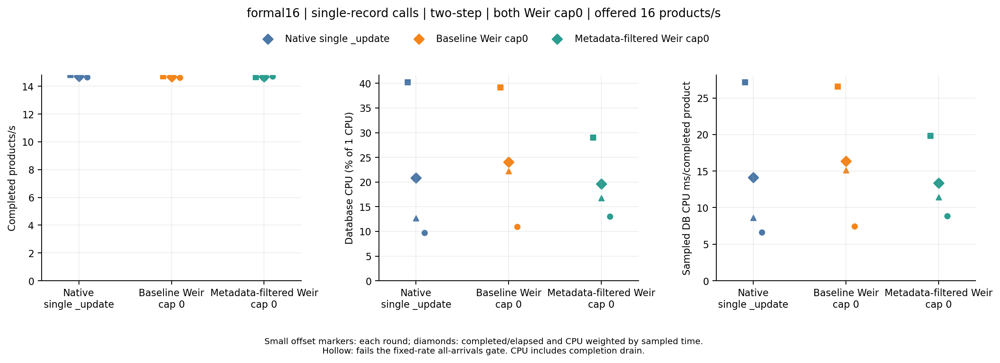
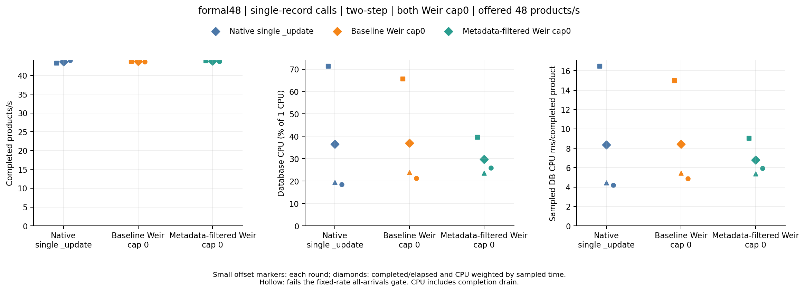
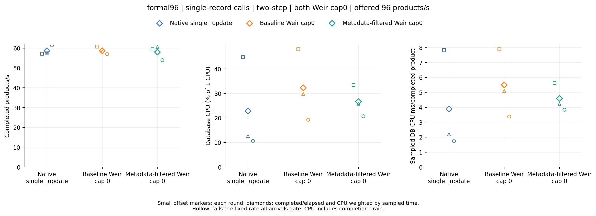

# Search metadata-only candidate, 2026-10-15

**This experiment does not establish consistent database-CPU savings or higher throughput for the metadata-only candidate.** At offered rates 16 and 48 products/s, all paths completed every arrival and passed all three rounds' gates. Candidate/baseline completed throughput stayed within 0.6%, but database CPU per completed product decreased in rounds 1 and 2 and increased in round 3. No comparison, including either Weir path against native, passed the predeclared three-round savings rule.

This candidate is exactly `745501319ae59a16351294c2eaed58019288c3ad`. Its production change only limits the response fields of each fresh Search metadata inspection. It retains the baseline batch keys, per-index document reads, execution, durability, visibility, and uncached inspection policy. The previously rejected cross-index batching candidate `b13318ffcfde662d5f77209ef88d689bdcd2433d` is separate; [its complete negative evidence remains archived](../search-batching-2026-10-15/README.md). These runs assess the final metadata-only version of Weir PR 66, not that earlier implementation.

## Result

All three workflows succeeded. All **27 timed stages** passed immutable source/binary, command, process, ownership, application-call, completion arithmetic, persisted-field, and independent offline Go audits. Every stage checked all **769 seeded documents**, with zero failed, indeterminate, or timed-out dispatched business operations. All **45 original artifact files** passed compressed/uncompressed hash and length verification. Clipped database CPU sampling coverage was **99.9755–99.9893%**. Eighteen stages passed the stricter all-arrivals gate: all paths and rounds at 16 and 48; no stage at 96.

At 16, candidate/baseline CPU ms/completed-product ratios were **0.745, 0.757, and 1.189**, while throughput ratios were **0.994, 0.998, and 1.006**. At 48, the CPU ratios were **0.603, 0.984, and 1.214**, with throughput ratios **1.003, 0.998, and 1.003**. The third-round CPU reversal at both rates prevents the predefined consistent-savings claim. Pooled CPU averages are retained in the analysis, but cannot override that failed rule.

At 96, every path rejected arrivals and failed the sustainable-arrivals gate. Candidate completed **4033/5760** and rejected **1727**, compared with baseline **4103/5760** and **1657** rejected, and native **4154/5760** and **1606** rejected. Candidate/baseline throughput ratios were **0.977, 1.040, and 0.947**; CPU/product ratios were **0.714, 0.828, and 1.135**. This does not establish greater capacity or equal-load throughput. CPU quota, concurrency, and query-visibility waits do not identify the actual limiting resource.

Each rate is a separate workflow/runner. Compare paths within one workflow and round; do not compare absolute CPU or QPS across rate runners.

| Offered products/s | Path | Completed / offered | Rejected | Completed products/s range | DB CPU ms/completed-product range | Worst p99 upper bound (s) | Worst drain (s) | All three arrival gates |
| --- | --- | --- | --- | --- | --- | --- | --- | --- |
| 16 | Native single `_update` | 960/960 | 0 | 14.654–14.809 | 6.656–27.122 | 3.146 | 1.837 | Pass |
| 16 | Baseline Weir cap0 | 960/960 | 0 | 14.635–14.733 | 7.458–26.572 | 3.146 | 1.865 | Pass |
| 16 | Metadata-filtered Weir cap0 | 960/960 | 0 | 14.650–14.717 | 8.865–19.798 | 3.146 | 1.842 | Pass |
| 48 | Native single `_update` | 2880/2880 | 0 | 43.292–43.982 | 4.203–16.471 | 3.670 | 2.175 | Pass |
| 48 | Baseline Weir cap0 | 2880/2880 | 0 | 43.595–43.840 | 4.890–14.987 | 4.719 | 2.021 | Pass |
| 48 | Metadata-filtered Weir cap0 | 2880/2880 | 0 | 43.705–43.912 | 5.375–9.034 | 3.932 | 1.965 | Pass |
| 96 | Native single `_update` | 4154/5760 | 1606 | 57.140–61.446 | 1.733–7.830 | 5.243 | 3.924 | Fail |
| 96 | Baseline Weir cap0 | 4103/5760 | 1657 | 57.010–60.846 | 3.380–7.891 | 5.767 | 3.633 | Fail |
| 96 | Metadata-filtered Weir cap0 | 4033/5760 | 1727 | 53.979–60.699 | 3.837–5.634 | 5.767 | 3.625 | Fail |

The exact candidate/baseline paired ratios retain every round, including overloaded rows. A CPU ratio below 1 is insufficient unless both paths also pass all arrival gates and maintain comparable completed throughput.

| Offered products/s | Round | Completed-throughput ratio | DB CPU ms/completed-product ratio | Both pass arrival gate |
| --- | --- | --- | --- | --- |
| 16 | 1 | 0.994410 | 0.745071 | Yes |
| 16 | 2 | 0.998189 | 0.756506 | Yes |
| 16 | 3 | 1.005570 | 1.188547 | Yes |
| 48 | 1 | 1.003441 | 0.602763 | Yes |
| 48 | 2 | 0.997517 | 0.983625 | Yes |
| 48 | 3 | 1.002528 | 1.213750 | Yes |
| 96 | 1 | 0.976701 | 0.713951 | No |
| 96 | 2 | 1.040265 | 0.828117 | No |
| 96 | 3 | 0.946831 | 1.135213 | No |

Comparisons against native also reverse their CPU direction. At both fully admitted rates the metadata-only Weir path uses less sampled database CPU/product than native in round 1, then more in rounds 2 and 3. The measured throughput remains comparable, so these observations still do not establish Weir's intended database-load advantage.

| Offered products/s | Round | Metadata-only / native throughput ratio | Metadata-only / native DB CPU ms/product ratio |
| --- | --- | --- | --- |
| 16 | 1 | 0.989325 | 0.729958 |
| 16 | 2 | 0.996484 | 1.330095 |
| 16 | 3 | 1.004286 | 1.331808 |
| 48 | 1 | 1.014308 | 0.548468 |
| 48 | 2 | 0.999219 | 1.209402 |
| 48 | 3 | 0.993714 | 1.412259 |







Small markers retain each round; diamonds aggregate completed/elapsed and CPU weighted by sampled coverage within that workflow. Hollow markers fail the all-arrivals gate. See [every stage](analysis/stages.csv), [all paired comparisons](analysis/paired-rounds.csv), [strict claim checks](analysis/comparisons.csv), and [full analysis](analysis/analysis.json). Smaller metadata response bytes in separate protocol tests must not be presented as this benchmark proving a throughput or CPU benefit.

## Method and provenance

The [prospective plan](PLAN.md) and analysis sources were committed and pushed as `18c3c7aac946108f5202feab4496d517ad1c86ad` **before dispatch**. The candidate source was already frozen in that commit. URLs and [dispatch receipts](dispatch-receipts.json) were committed as `91cdd1e` before result inspection. Rates, gates, durations, caps, queues, deadlines, retries, visibility, and durability were not changed after seeing the measurements. [The manifest](manifest.json) binds exact sources, run URLs, and raw paths.

Client/workflow source is `8bdfe233f4baad325c66718a4cdec1c8c436a41a`; baseline Weir is `0f6fac3edb462e088decff98b67560dae2c23c9a`; metadata-only Weir is `745501319ae59a16351294c2eaed58019288c3ad`. Both server sources are clean immutable commits with distinct executable hashes, and before/after binary hashes match. Both live Weir execution limits are attested as `max_in_flight=0` before and after every timed stage.

| Rate | Workflow | Result |
| --- | --- | --- |
| 16 | [38734590273](https://github.com/batchstream/weir-tests/actions/runs/38734590273) | Success; nine stages audited |
| 48 | [38734598763](https://github.com/batchstream/weir-tests/actions/runs/38734598763) | Success; nine stages audited |
| 96 | [38734606631](https://github.com/batchstream/weir-tests/actions/runs/38734606631) | Success; nine stages audited |

These are all three planned attempts; none was rerun, substituted, or omitted. [Final workflow snapshots](workflow-runs.json) preserve source head, conclusion, and timestamps. Original negative or aborted attempts would remain in the ledger and raw archive; no additional attempt occurred in this experiment.

The existing `two-step` single-record workload runs four OS processes with 128 total goroutine workers, page size 1, one queued arrival per worker, ten-second planned-business deadlines, and four total Search conflict attempts. Native sends one document per cached atomic Painless `_update`; Weir sends one document per SDK `Mutate`. Actual application-call histograms establish exactly one record per invocation in every stage. Client processes and connection pools persist across ten seconds of warmup and twenty seconds of timed arrivals, followed by full drain. Each product waits for reconciliation, then product acknowledgement, then both independently dispatched seller acknowledgements. The existing occasional shared placeholder remains a separate seller call. All required acknowledgements are durably query-visible.

Each workflow uses one owned Elasticsearch container shared by its paths: 1 CPU quota, 1536 MiB container memory, 512 MiB heap, two indices with one primary and zero replicas, one-second refresh, and request translog durability. Weir batch size stays 32 with 4096 pending records; native pool size is 96 per process. Resets require two quiet seconds of index/merge/flush observations before warmup and timing. Business repositories remain untouched; Sink and new Lua APIs are excluded. Extra Weir CPU is outside the requested database-load comparison.

Completion throughput includes the entire drain. Planned-arrival latency includes queueing; rejected arrivals have no completed latency. Full-field checks and an independent offline Go audit reconstruct expected records from acknowledged arrivals, preserving types and values. The finite working set, same-host clients, brief warmup, and single-node database do not establish production key frequencies, arbitrary Lua behavior, replicas, distributed network effects, or multi-node scaling. Database history and JVM/JIT can vary with order: native CPU changes substantially across rounds despite the brief warmup. This experiment does not establish a stationary production estimate.

Database CPU uses owned-container cumulative counters clipped to measured intervals and weighted only by sampled coverage, without extrapolation. The HTTP observer is disabled on every path; backend HTTP counts and bytes remain **null**, not zero. Instrumented application calls and adapter records/execution do not count backend HTTP commands. Database get/index/refresh/merge observations and adapter fill remain in the full analysis. **Equal configured CPU quota does not mean equal actual database load.** These fixed-rate tests do not demonstrate maximum capacity or higher throughput at equal measured load.

Formal measurement requires complete source/ownership/cleanup/field/offline audits, zero failed/unknown/timed-out dispatched work, and at least 80% CPU coverage. The stricter all-arrivals gate also requires zero rejection, offered equals completed, planned-to-visible p99 upper bound ≤5 seconds, drain ≤3 seconds, and maximum generator lag ≤50 ms in each round. A lower-CPU claim at comparable throughput requires both paths to pass those gates in all three paired rounds, each completed-QPS ratio in `[0.95, 1.05]`, and each CPU ms/completed-product ratio below 1. Histogram upper bounds retain the existing ≤12.5% plus one-microsecond approximation. These are experimental gates, not production SLOs, and three rounds do not establish confidence intervals.

## Reproduction and archive

All 45 original files remain in the three raw directories. Each deterministic gzip has compressed and uncompressed SHA-256 plus original byte length in `files.json`; owned database logs have ownership/length receipts. Cleanup receipts attest the final owned process and removed container. Earlier server replacements wait synchronously in fixture code, without separate historical OS termination receipts.

The auditor was freshly built from a new empty extraction of `git archive` at exact client source `8bdfe2...`, with Go 1.27.1, `GOPROXY=off`, and `GOSUMDB=off`. Its actual SHA-256 is `88f2480de227ed43f3d889a9c305077fc01db393de8107813911931b86b7eec0`; the [build receipt](auditor-build.json) records the source archive hash and build command. Building at another path, on another platform, or with different flags may change the executable hash. Generated analysis records the executable actually used and all three frozen script hashes. Build an auditor from the exact clean client source, then run this evidence checkout without databases:

```sh
audit_source=$(mktemp -d /tmp/weir-search-metadata-auditor.XXXXXX)
git archive 8bdfe233f4baad325c66718a4cdec1c8c436a41a | tar -x -C "$audit_source"
GOPROXY=off GOSUMDB=off go -C "$audit_source" build \
  -o "$PWD/.tools/weir-crawler-search-metadata-audit" ./cmd/weir-crawler
python3 results/search-metadata-2026-10-15/analyze.py \
  --manifest results/search-metadata-2026-10-15/manifest.json \
  --auditor .tools/weir-crawler-search-metadata-audit \
  --output /tmp/weir-search-metadata-analysis
```

Use the pinned `requirements-plot.txt` environment for optional figures:

```sh
python3 results/search-metadata-2026-10-15/plot.py \
  --analysis /tmp/weir-search-metadata-analysis/analysis.json \
  --output /tmp/weir-search-metadata-plots
```

The previous batching and single-record reports remain unchanged. This report preserves this candidate's complete result independently of the eventual merge decision.

A separate [database-pressure calibration plan](../crawler-pressure-2026-10-15/PLAN.md) examines whether higher independent client concurrency can sustain greater actual database load. It is a different experiment with its own sources and run ledger; this report contains none of its results and makes no prediction about them.
