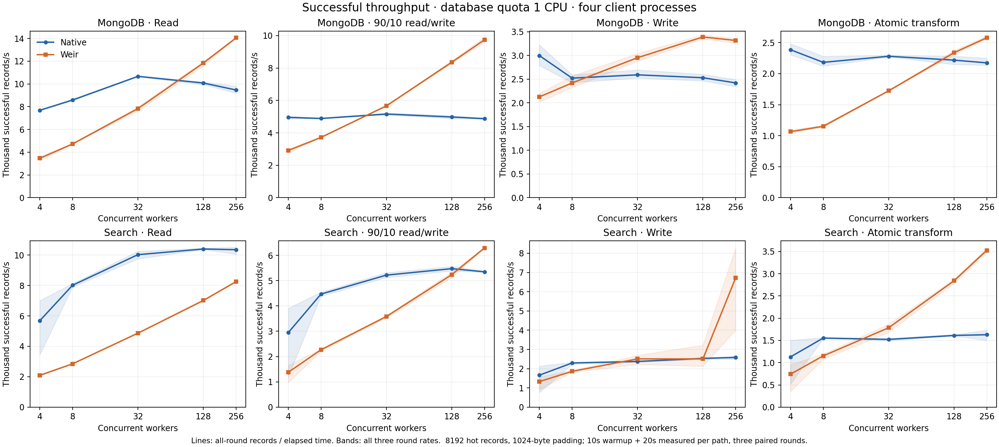
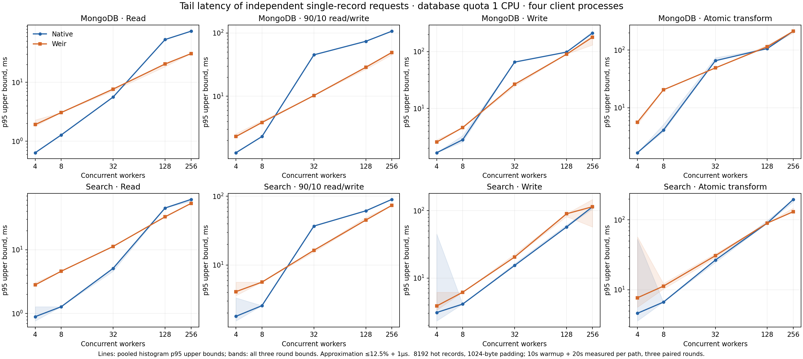
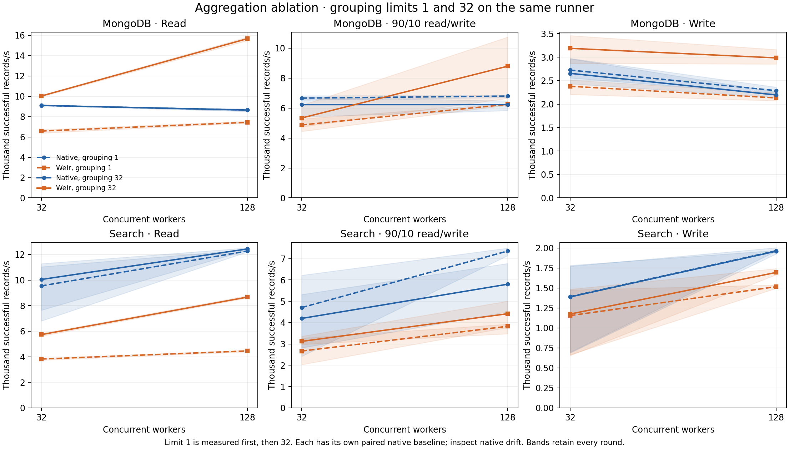
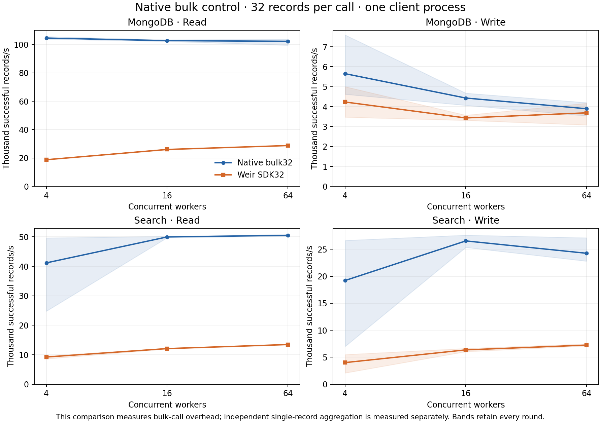

# Weir value benchmark — 2026-10-15

**Weir earns its extra request path when independent concurrent small requests
can be aggregated. The measured benefit is conditional on workload and available
CPU; a direct native bulk client remains substantially faster.** This is an
executed Linux benchmark against real MongoDB and Elasticsearch, with published
original evidence, rather than an assertion based on fewer database commands.

The complete matrix contains 10 successful workflows, 15 workload invocations,
30 backend reports, 94 paired comparisons and 564 timed stages. All **95,142,464
records succeeded**, with **0 errors, 0 timeouts and 0 unknown mutation outcomes**.
Every final persisted-state verification and owned-fixture cleanup passed.
Timed stages total 3.14 hours, excluding warmup and preparation; workflows run
in parallel. No failed case or unfavorable round was discarded.

## Measured benefit and its limits

The following are observed rates at matched concurrency, using a **1-CPU database
quota**. Each path shares a four-logical-CPU runner with its database; Weir has
no separate CPU limit. Equal database quota does **not** mean equal total CPU
demand. Rates include all three rounds, weighted by elapsed time. Latency columns
are pooled histogram upper bounds in milliseconds, with approximation up to
12.5% + 1µs. See [all comparisons and all rounds](TABLES.md).

| Backend and work | Workers | Native records/s | Weir records/s | Throughput change | Native p95 / p99 ms | Weir p95 / p99 ms |
| --- | ---: | ---: | ---: | ---: | --- | --- |
| MongoDB read | 256 | 9,468.6 | 14,050.8 | +48.4% | 73.727 / 90.111 | 30.719 / 40.959 |
| MongoDB 90/10 read/write | 256 | 4,876.2 | 9,743.8 | +99.8% | 106.495 / 180.223 | 49.151 / 73.727 |
| MongoDB write | 128 | 2,530.2 | 3,390.3 | +34.0% | 98.303 / 425.983 | 90.111 / 212.991 |
| MongoDB fixed atomic transform | 256 | 2,174.3 | 2,578.7 | +18.6% | 212.991 / 491.519 | 212.991 / 491.519 |
| Search 90/10 read/write | 256 | 5,351.2 | 6,296.7 | +17.7% | 90.111 / 98.303 | 73.727 / 90.111 |
| Search fixed atomic transform | 256 | 1,628.6 | 3,526.0 | +116.5% | 196.607 / 229.375 | 131.071 / 180.223 |

Each highlighted throughput improvement exceeds 10% in **every paired round**.
This is an interpretation threshold, not a confidence interval. For example,
MongoDB mixed traffic's paired ratios are 1.973 / 2.018 / 2.004. Its native round
rates are 4,871.2 / 4,911.4 / 4,846.1 and Weir's are 9,611.2 / 9,909.8 / 9,710.4
records/s. MongoDB transform throughput improves, but its pooled p95 and p99 upper
bounds are unchanged; it is not evidence of a tail-latency improvement.

The transform baseline is strong: one MongoDB atomic update pipeline or one
Search Painless update request computes `revision = 1 - revision`. It performs
no unnecessary native read or client transaction. Weir computes the same result
through Lua. This establishes a result for this fixed transform; it does not
prove an advantage over every native expression or for arbitrary Lua programs.





The full curves expose the counterexamples:

- At four workers, ordinary MongoDB read/mixed/write throughput is respectively
  54.9% / 41.2% / 29.0% lower through Weir. MongoDB read p95 rises from 0.639 to
  1.919 ms. Low concurrency does not amortize the extra process and transport.
- Search pure reads remain slower at **every tested concurrency**: 20.3% lower
  even at 256 workers. Weir does not justify replacing a direct read client here.
- Search ordinary writes at 256 workers show 2,583.6 native versus 6,715.7 Weir
  records/s, but Weir's rounds span **4,002.5–8,275.2**. At 128 workers it averages
  1.1% below native and two of three rounds lose. The 256-worker result is an
  observation with large variability, not a stable 2.6× sizing multiplier.
- Several early Search rounds vary substantially after the fixed 10s warmup.
  Backend JIT/cache evolution is a possible explanation, not a measured cause.
  Every round remains in the plots and totals; there is no selected steady-state
  subset.

## Does aggregation cause the benefit?

The ablation measures grouping limits **1, then 32 on the same runner**, each
with its own native baseline. Grouping 1 disables cross-request aggregation.
The order between limits is fixed, so native drift must be checked.

| MongoDB work, 128 workers | Native, group 1 | Weir, group 1 | Native, group 32 | Weir, group 32 | Native drift |
| --- | ---: | ---: | ---: | ---: | ---: |
| Read, records/s | 8,644.4 | 7,433.0 | 8,643.0 | 15,667.8 | approximately 0% |
| Write, records/s | 2,286.9 | 2,131.6 | 2,194.3 | 2,985.1 | −4.0% |

For reads, Weir changes from 14.0% below native to 81.3% above it while the native
rate stays essentially unchanged. Selected MongoDB commands per successful record
fall from 1.0000 to 0.1251; the observed adapter average is 7.99 records, despite
the configured maximum of 32. For writes, Weir changes from 6.8% below native to
36.0% above it, with 0.2620 selected commands/record and a 3.82-record adapter
average. This supports aggregation as a cause of the observed MongoDB benefit.
It does not establish monetary savings.

MongoDB mixed ablation varies across rounds (group-32 paired ratios
1.043 / 1.843 / 1.388), so it does not meet the all-round 10% threshold.
Search mixed ablation's native baseline drifts by −21.2%; a clean causal
percentage cannot be assigned. Search read aggregation improves Weir's own
rate but still leaves it below native. All ablation cases are retained below.



## Native bulk is a stronger alternative when callers can batch

Both paths receive 32 records per call in this control. There is one client
process; concurrency counts outstanding bulk calls. This differs from the four
independent single-record client processes above.

MongoDB native bulk reads deliver **102,196–104,461 records/s** across the tested
4/16/64 workers; Weir SDK reads deliver **18,823–28,782**. Weir is 71.8–82.0%
slower. Search bulk reads are 73.3–77.6% slower through Weir, and Search bulk
writes are 70.1–79.1% slower. MongoDB bulk write averages also favor native;
at 64 workers the small 5.3% difference has mixed round outcomes.

**An application that can efficiently form native batches should prefer those
batches for these workloads.** Cross-caller aggregation is the relevant Weir
use case, rather than replacing an already efficient bulk implementation.



## CPU, memory and capacity qualification

Weir consumes additional compute. For the highlighted MongoDB 256-worker read
and mixed cases its Prometheus process-CPU counter window measures respectively
**140.8 and 175.0 µs per successful record**, and sampled Weir RSS reaches
**39.8 and 40.0 MiB**. The corresponding database mean CPU is about 35.5% and
63.7% of its quota, versus approximately 100% for native. This moves work from
the database to the service/clients; it is not proof of lower total host CPU.
The 256-worker Search transform uses 564.0 µs of Weir CPU per successful record
and reaches 51.9 MiB sampled Weir RSS. Client CPU sampling has coarse Linux `ps`
resolution and cannot establish small total-cost savings. Full CPU coverage,
per-client samples, database container memory, I/O and network evidence are kept
in the JSON; [TABLES.md](TABLES.md) includes resource costs for every comparison.

MongoDB ordinary writes at 128 workers are the primary case where **both** paths
meet the declared database-CPU saturation and next-level plateau conditions:
all rounds cover at least 80% of timed work with valid samples, mean CPU is at
least 90% of the quota, that threshold holds for at least 80% of measurement,
and the 256-worker successor adds no more than 10% throughput. The observed
2,530.2 → 3,390.3 records/s supports a 34.0% database-constrained throughput
improvement within this workload and ladder. Read/mixed Weir results do not
qualify as maximum database capacity: Weir's database CPU is lower and its rate
still rises with concurrency. The highest tested level alone cannot establish
a plateau. No number here is a production capacity guarantee.

The 2-CPU database sensitivity runs weaken several apparent advantages:
MongoDB read ratios at 32/128/256 workers are 0.594 / 0.898 / 0.975, mixed ratios
0.637 / 0.960 / 1.141, and write ratios 0.806 / 1.087 / 1.140. Only the final
mixed case exceeds 10% in all three paired rounds. Ordinary Search remains
slower in every 2-CPU case. These run on separate machines with different CPU
models: compare paired ratios, not raw rates across runners. They show that
the value depends on the database budget; they are not a controlled CPU-only
intervention.

## Reproduce and audit

Read the full [method and qualification rules](METHOD.md). The fixture is a hot
8192-record namespace with 1024-byte padding, disjoint writer keys, one Store
owner and loopback networking. All single-record paths use four independent
client processes, a 10s complete request budget, 10s warmup and 20s timed work
per path, three AB/BA paired rounds. Both paths retain matching durability and
visibility policies. The fixture starts both owned backend containers; the
unselected backend is idle. Runners expose four logical CPUs and about 15.6 GiB
RAM, with multiple Intel Xeon and AMD EPYC models recorded per receipt. Warm
data, no planned write conflicts and shared-host scheduling limit applicability.
There is no evidence here for cold data, production monetary cost, cross-host
tail latency, conflict-heavy writes or a multi-owner fleet.

Frozen measured code and dependencies:

- [Weir server `8955cde`](https://github.com/batchstream/weir/commit/8955cde10e574dae55d890b0c9c824fd39219d1c),
  immutable module `v0.2.1-0.20261015053327-8955cde10e57`.
- [Measured harness `99d7951`](https://github.com/batchstream/weir-tests/commit/99d7951bc935c811bc155a40e390ef7a200e3fa5),
  Go 1.27.1, SDK v0.15.0, protocol v0.13.0. Later test/workflow changes in
  [PR #16](https://github.com/batchstream/weir-tests/pull/16) do not change the
  measured `cmd/` or `internal/` code except integration contract tests.
- MongoDB 8.0.32, image
  `mongo@sha256:d0d926f94df099bff534b7ee5b5986458131a22489dfff8664509af0c1e2ca9c`.
- Elasticsearch 8.19.22, image
  `docker.elastic.co/elasticsearch/elasticsearch@sha256:e98f9c3b09beb2fbb9eaf667d602df3f0e00bd3644138b8458dc17ba1a675595`.

| Executed workflow | Role |
| --- | --- |
| [38696048980](https://github.com/batchstream/weir-tests/actions/runs/38696048980) | Primary read / mixed / write |
| [38696204834](https://github.com/batchstream/weir-tests/actions/runs/38696204834) | Lua against native atomic controls |
| [38696214380](https://github.com/batchstream/weir-tests/actions/runs/38696214380) | Native bulk read |
| [38696221934](https://github.com/batchstream/weir-tests/actions/runs/38696221934) | Native bulk write |
| [38696280996](https://github.com/batchstream/weir-tests/actions/runs/38696280996) | Read ablation |
| [38696285559](https://github.com/batchstream/weir-tests/actions/runs/38696285559) | Mixed ablation |
| [38696292242](https://github.com/batchstream/weir-tests/actions/runs/38696292242) | Write ablation |
| [38696342580](https://github.com/batchstream/weir-tests/actions/runs/38696342580) | 2-CPU read |
| [38696347409](https://github.com/batchstream/weir-tests/actions/runs/38696347409) | 2-CPU mixed |
| [38696351686](https://github.com/batchstream/weir-tests/actions/runs/38696351686) | 2-CPU write |

The 155 original JSON/log/config files are retained in deterministic gzip under
[`raw/`](raw), including exact commands, clean source/binary identities before
and after execution, fixture manifests and cleanup receipts. Both compressed and
decompressed SHA-256 hashes are in [raw-inventory.json](raw-inventory.json).
The complete declared matrix is in [runs.json](runs.json), the analysis inputs in
[manifest.json](manifest.json), and collection failures in
[collection-failures.json](collection-failures.json) (empty).
Raw artifacts remain useful after GitHub's artifact retention expires.

Recompute hashes, matrix coverage, rates, pooled histograms and all tables
offline from this checkout using Python 3; no database, network or credentials
are needed. Use a fresh output directory to compare with the retained analysis:

```sh
python3 -B results/value-2026-10-15/verify.py
python3 -B results/value-2026-10-15/analyze.py \
  --manifest results/value-2026-10-15/manifest.json \
  --output /tmp/weir-value-audit/analysis
cmp results/value-2026-10-15/analysis.json /tmp/weir-value-audit/analysis.json
cmp results/value-2026-10-15/analysis.csv /tmp/weir-value-audit/analysis.csv
python3 -B results/value-2026-10-15/tables.py \
  --analysis /tmp/weir-value-audit/analysis.json \
  --output /tmp/weir-value-audit/TABLES.md
cmp results/value-2026-10-15/TABLES.md /tmp/weir-value-audit/TABLES.md
```

Plotting additionally requires the pinned Matplotlib in
[requirements-plot.txt](requirements-plot.txt). After installing it in an
isolated Python environment, regenerate the PNG/SVG figures with:

```sh
python results/value-2026-10-15/plot.py \
  --analysis /tmp/weir-value-audit/analysis.json --output /tmp/weir-value-audit
```

To rerun measurements, use the explicit `saturation.yml` dispatch controls
documented in the repository README and the exact commands retained in each
receipt. Choose new output directories and retain every round. `fetch.py` and
`pack.py` reproduce the archive from the workflow IDs in `runs.json` while the
remote artifacts remain available. Default tests do not launch these long runs.
